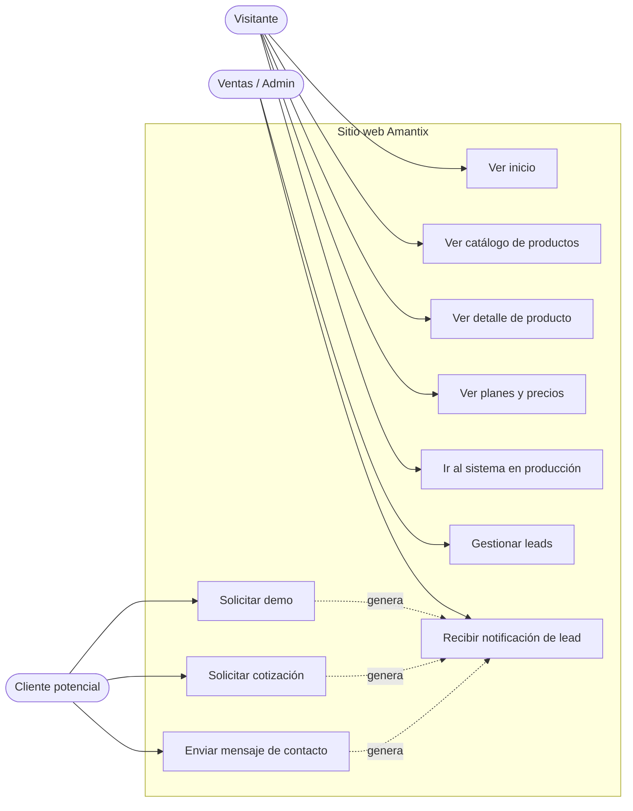
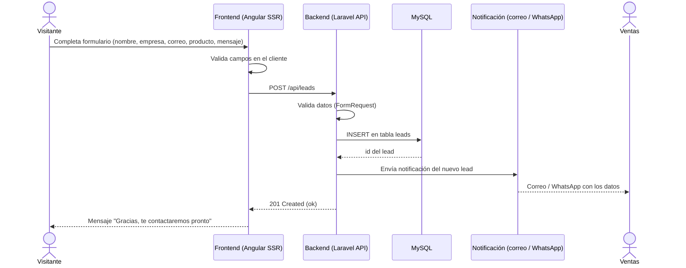
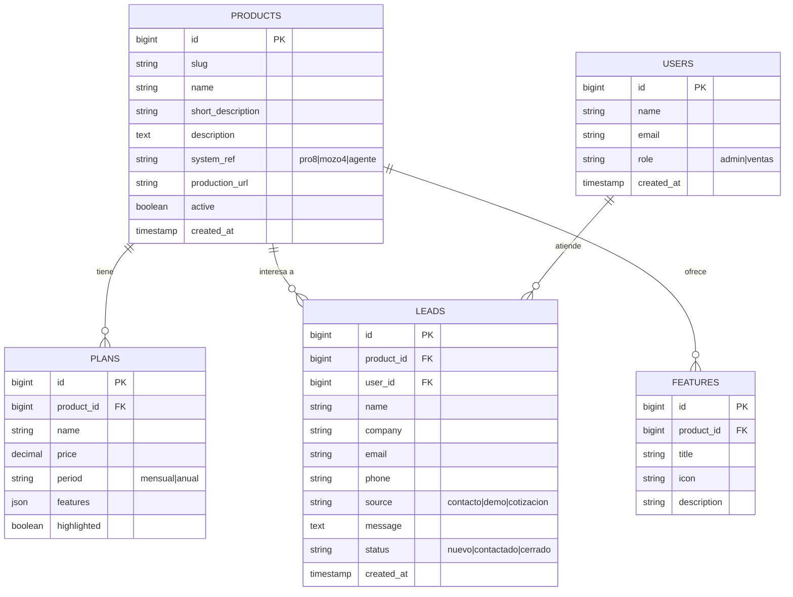
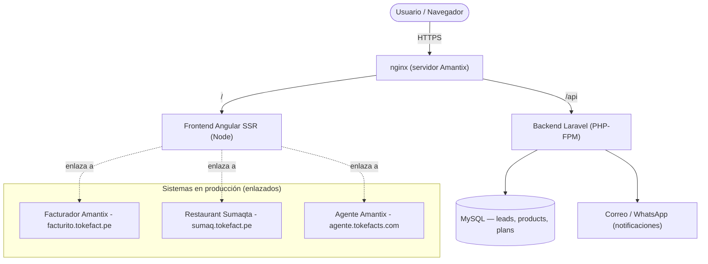
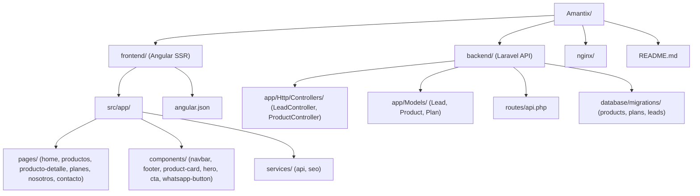
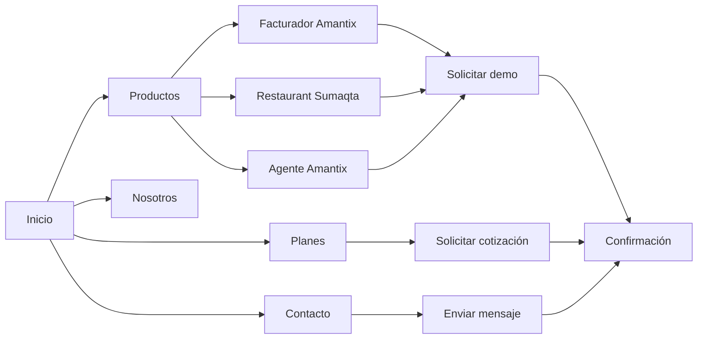

# Amantix — Sitio web corporativo

Sitio web institucional de **Amantix**, empresa de desarrollo de software que crea y comercializa sistemas de gestión empresarial. El sitio presenta la empresa, su catálogo de productos y capta clientes (leads) para la venta de los sistemas.

---

## 1. Objetivo del sitio

Una web de **marketing + captación** (no es uno de los sistemas en sí) que:

- Presenta a Amantix y su propuesta de valor.
- Muestra el **catálogo de productos** (3 sistemas) con sus funcionalidades, planes y casos de uso.
- Permite **solicitar una demo / cotización** y contactar a ventas.
- Sirve de punto de entrada (con enlaces) a cada sistema en producción.

---

## 2. Productos de Amantix (catálogo)

El sitio documenta y vende tres sistemas propios:

### 2.1. Facturador Amantix
> Sistema base: `pro8`

Sistema de **facturación electrónica** integral para Perú, conectado a **SUNAT**.

- Comprobantes electrónicos (factura, boleta, nota de crédito/débito), guías de remisión (GRE).
- Multi-tenant: cada empresa cliente opera con su propio RUC y base de datos aislada.
- **SIRE** — extracción del Registro de Compras/Ventas electrónico desde SUNAT.
- Inventario, almacenes, listas de precios, POS, reportes y panel del contador.
- Stack del sistema: Laravel + frontend SPA + MySQL (multi-tenant `hyn/tenancy`).
- En producción: `facturito.tokefact.pe`.

### 2.2. Restaurant Sumaqta
> Sistema base: `mozo4`

Sistema de **gestión para restaurantes** (punto de venta gastronómico).

- Toma de comandas desde el celular del mozo; impresión en cocina/caja.
- Gestión de mesas, salones, carta/menú, pedidos y cuentas.
- Impresión de comandas (la PC con la app imprime vía QZ Tray; el celular registra la orden).
- Integración con facturación electrónica para emitir el comprobante.
- En producción: `sumaq.tokefact.pe`.

### 2.3. Agente Amantix
> Sistema base: `agente`

Plataforma SaaS para operar **agentes multibancarios** en Perú.

- Multi-tenant por subdominio (`empresa.midominio.pe`), cada cliente con su BD aislada.
- Cajeros registran ingreso/salida de dinero contra múltiples billeteras (BBVA, BCP, Yape, Plin, Western Union, efectivo, etc.).
- Emisión de boletas SUNAT, préstamos y cierre de caja diario.
- Panel de administración central + panel por empresa.
- En producción: `agente.tokefacts.com` (+ `admin.agente.tokefacts.com`).

---

## 3. Tecnologías del sitio web

| Capa | Tecnología |
|---|---|
| **Frontend** | **Angular** (SSR para SEO) + TypeScript |
| **Backend / API** | **Laravel** (PHP) — API REST para formularios de contacto/leads |
| **Base de datos** | MySQL |
| **Estilos** | (a definir: Tailwind / SCSS) |
| **Servidor web** | nginx |
| **Despliegue** | servidor propio (VPS) + dominio Amantix |

> Misma base tecnológica que los productos (Angular + Laravel), para reutilizar conocimiento y componentes.

---

## 4. Estructura del sitio (secciones / páginas)

| Página | Contenido |
|---|---|
| **Inicio (Home)** | Hero con propuesta de valor, resumen de los 3 productos, CTA "Solicitar demo". |
| **Productos** | Listado de los 3 sistemas con tarjetas (icono, nombre, descripción corta). |
| **Producto — Facturador Amantix** | Detalle, funcionalidades, capturas, planes, CTA. |
| **Producto — Restaurant Sumaqta** | Detalle, funcionalidades, capturas, planes, CTA. |
| **Producto — Agente Amantix** | Detalle, funcionalidades, capturas, planes, CTA. |
| **Planes / Precios** | Comparativa de planes por producto. |
| **Nosotros** | Quiénes somos, misión, equipo. |
| **Contacto** | Formulario (nombre, empresa, correo, teléfono, producto de interés, mensaje) → guarda lead y notifica por correo/WhatsApp. |
| **Demo / Cotización** | Formulario de solicitud de demo o cotización. |

Elementos transversales: navbar con logo + menú, footer con contacto/redes, botón flotante de WhatsApp.

---

## 5. Estructura del proyecto (propuesta)

```
Amantix/
  frontend/            # Angular (SSR)
    src/app/
      pages/           # home, productos, producto-detalle, planes, nosotros, contacto
      components/       # navbar, footer, product-card, cta, hero, whatsapp-button
      services/        # api (contacto/leads), seo
    angular.json
  backend/             # Laravel (API)
    app/Http/Controllers/  # ContactController, LeadController
    routes/api.php          # POST /contact, POST /demo
    database/migrations/    # leads
  nginx/               # vhost del sitio
  README.md
```

(La estructura final se ajusta al implementar; esta es la guía inicial.)

---

## 6. Funcionalidades del sitio (alcance)

- **SEO**: Angular SSR, metadatos por página, sitemap, Open Graph (importante por ser sitio de venta).
- **Catálogo de productos** con páginas de detalle.
- **Captación de leads**: formularios de contacto y de demo → se guardan en BD (tabla `leads`) y se notifican por correo (y opcionalmente WhatsApp).
- **Responsive** (móvil/escritorio).
- **Multi-idioma** (opcional, a futuro): español por defecto.
- **Integración**: enlaces directos a cada sistema en producción.

---

## 7. Datos de leads (tabla `leads`)

```
id, name, company, email, phone, product_interest (facturador|restaurant|agente),
message, source (contacto|demo|cotizacion), created_at, updated_at
```

---

## 8. Productos y dominios de producción (referencia)

| Producto en el sitio | Sistema | Dominio en producción |
|---|---|---|
| Facturador Amantix | pro8 | `facturito.tokefact.pe` |
| Restaurant Sumaqta | mozo4 | `sumaq.tokefact.pe` |
| Agente Amantix | agente | `agente.tokefacts.com` |

---

## 9. Próximos pasos

1. Inicializar el proyecto Angular (SSR) en `frontend/` y la API Laravel en `backend/`.
2. Definir identidad visual (logo, paleta, tipografía) de Amantix.
3. Maquetar Home + páginas de producto.
4. Implementar formularios de contacto/demo → API `leads` + notificación.
5. Configurar SEO (SSR, metadatos, sitemap) y desplegar con nginx en el dominio Amantix.

---

## 10. Diagramas

Diagramas en Mermaid (se renderizan en GitHub y en cualquier visor compatible).

### 10.1. Casos de uso



### 10.2. Secuencia — Solicitar demo / contacto



### 10.3. Entidad-relación



### 10.4. Arquitectura de despliegue



### 10.5. Arquitectura de carpetas



### 10.6. Flujo de navegación



---

## 11. Manual de marca

Reglas de uso de la marca Amantix en la web, los sistemas, los documentos comerciales, las redes y los impresos. Toda pieza nueva parte de aquí.

### 11.1. Esencia

Amantix es una casa de software peruana, nacida en Puerto Maldonado en 2026. Hace sistemas que manejan facturación SUNAT, caja y operaciones bancarias.

El nombre viene de la mantis religiosa. La marca la presenta como una máquina: quieta, precisa y sin margen de error.

| Elemento | Texto |
|---|---|
| Lema | Software que tu negocio puede facturar, operar y controlar. |
| Promesa | Cuadra al centavo y es válido ante SUNAT. |
| Respaldo | Validez ante SUNAT y seguridad por diseño. |
| Concepto visual | Confianza diseñada. |
| Origen | Hecho en Puerto Maldonado, Perú. |

Valores:

| Valor | Cómo se dice |
|---|---|
| Precisión | Si maneja dinero o impuestos, tiene que cuadrar siempre. |
| Seguridad | Aislamiento por empresa, cifrado y trazabilidad por defecto. |
| Cercanía | Soporte real, en tu idioma, cuando lo necesitas. |

Personalidad:

| Somos | No somos |
|---|---|
| Precisos | Fríos |
| Serios | Aburridos |
| Cercanos | Informales |
| Seguros | Alarmistas |
| Peruanos, de provincia | Genéricos |

Solo se mencionan certificaciones que la empresa tenga vigentes. Hoy el respaldo es la validez ante SUNAT.

### 11.2. Logotipo

El logo tiene dos piezas:

| Pieza | Descripción |
|---|---|
| Isotipo | Mantis geométrica en navy con circuitos en latón y ojos en teal, dentro de un rombo de latón. La mantis se superpone al rombo y el trazo del rombo se corta donde ella lo cruza. |
| Logotipo | AMANTIX en Archivo 800, mayúsculas, tracking -0.02em. |

En texto corrido el nombre se escribe Amantix. AMANTIX en mayúsculas solo va en el logotipo y en las micro-etiquetas.

Versiones:

| Versión | Composición | Uso |
|---|---|---|
| Horizontal (principal) | Isotipo a la izquierda y AMANTIX a la derecha, centrados en vertical. Separación de 0,28 veces la altura del isotipo. La altura de las mayúsculas es la mitad de la del isotipo. | Web, documentos, firma de correo, presentaciones |
| Vertical | Isotipo arriba y AMANTIX centrado debajo. Separación de 0,2 veces la altura del isotipo. | Redes, portadas, piezas cuadradas, merchandising |
| Isotipo | Mantis y rombo, sin texto | Favicon, avatar, ícono de app, marca de agua |
| Isotipo simplificado | Rombo y silueta de la mantis en un solo color, sin circuitos | Tamaños menores a 24 px |

Área de respeto: alrededor del logo queda libre un espacio igual a la altura de la A de AMANTIX. En el isotipo solo, un cuarto de su ancho. Ningún texto, borde ni imagen entra en esa zona.

Tamaños mínimos:

| Versión | Pantalla | Impreso |
|---|---|---|
| Horizontal | 120 px de ancho | 30 mm de ancho |
| Vertical | 64 px de ancho | 18 mm de ancho |
| Isotipo | 24 px | 8 mm |
| Isotipo simplificado | 16 px | 5 mm |

Versiones de color:

| Fondo | Isotipo | Logotipo |
|---|---|---|
| Niebla o blanco | Color completo | Navy `#0F1D2E` |
| Navy o navy-pizarra | Cuerpo de la mantis en navy-pizarra `#2A3F54`, circuitos y rombo en latón, ojos en teal | Blanco |
| Monocromo oscuro | Todo navy | Navy |
| Monocromo claro | Todo blanco | Blanco |
| Premium (tarjetas, relieve, estampado) | Todo latón sobre navy | Latón |

Usos incorrectos:

- Deformar, estirar o rotar el logo.
- Cambiar los colores por otros que no estén en la paleta.
- Agregar sombras, degradados, brillos, contornos o efectos 3D.
- Poner el logo sobre fotos cargadas o fondos que no contrasten.
- Separar la mantis del rombo o cambiar el orden de las piezas.
- Escribir AMANTIX con otra fuente, en minúsculas o con otro espaciado.
- Usar el render 3D de la mantis como logo.
- Encerrar el logo en cajas, círculos o marcos que no sean el rombo.
- Agregar emojis, eslóganes o elementos pegados al logo.

### 11.3. Color

Paleta complementaria apagada: navy frío y latón cálido sobre un campo gris niebla. El teal queda para las señales de seguridad. Sin colores chillones.

Proporción en cada pieza: 60 % neutros (niebla y blanco), 30 % navy, 10 % latón. El teal no pasa del 5 %.

Colores principales:

| Nombre | Token | HEX | RGB | CMYK | Uso |
|---|---|---|---|---|---|
| Navy | `--ink` | `#0F1D2E` | 15 29 46 | 67 37 0 82 | Color de marca. Hero, footer, texto principal sobre claro. |
| Latón | `--brass` | `#B0894F` | 176 137 79 | 0 22 55 31 | Acento de marca. Botones principales, rombo, sello, subrayados. |
| Teal | `--teal` | `#2F6E68` | 47 110 104 | 57 0 5 57 | Seguridad y confianza: badges, validez SUNAT, foco de teclado, enlaces al pasar el cursor. |
| Niebla | `--mist` | `#EEF1F3` | 238 241 243 | 2 1 0 5 | Fondo de página. |
| Blanco | `--cloud` | `#FFFFFF` | 255 255 255 | 0 0 0 0 | Tarjetas y superficies. |

Colores de apoyo:

| Nombre | Token | HEX | RGB | CMYK | Uso |
|---|---|---|---|---|---|
| Navy-pizarra | `--steel` | `#2A3F54` | 42 63 84 | 50 25 0 67 | Superficies y bordes sobre navy. |
| Navy 2 | `--ink-2` | `#15263A` | 21 38 58 | 64 34 0 77 | Capas sobre navy. |
| Latón oscuro | `--brass-dark` | `#9C7943` | 156 121 67 | 0 22 57 39 | Botón principal al pasar el cursor. |
| Teal claro | `--teal-light` | `#7FA8A3` | 127 168 163 | 24 0 3 34 | Señales de seguridad sobre navy. |
| Superficie | `--surface` | `#F7F9FA` | 247 249 250 | 1 0 0 2 | Bloques alternos sobre blanco. |
| Pizarra | `--slate` | `#5A6B7B` | 90 107 123 | 27 13 0 52 | Texto secundario. |
| Pizarra 2 | `--slate-2` | `#7E8B98` | 126 139 152 | 17 9 0 40 | Texto secundario sobre navy. |
| Filete | `--line` | `#DCE2E6` | 220 226 230 | 4 2 0 10 | Filetes y divisores de 1 px. |
| Filete 2 | `--line-2` | `#C4CED6` | 196 206 214 | 8 4 0 16 | Bordes de botones secundarios e inputs. |
| Error | `--danger` | `#B0524F` | 176 82 79 | 0 53 55 31 | Solo mensajes de error. |

Los valores CMYK son de referencia. En impresos se pide prueba de color antes del tiraje.

Combinaciones de texto:

| Texto | Fondo | Contraste | Uso |
|---|---|---|---|
| Navy | Blanco | 17,0 : 1 | Cualquier tamaño |
| Navy | Niebla | 15,0 : 1 | Cualquier tamaño |
| Blanco | Navy | 17,0 : 1 | Cualquier tamaño |
| Blanco | Navy-pizarra | 10,8 : 1 | Cualquier tamaño |
| Navy | Latón | 5,3 : 1 | Botones principales |
| Latón | Navy | 5,3 : 1 | Micro-etiquetas y titulares sobre navy |
| Teal | Blanco | 5,9 : 1 | Cualquier tamaño |
| Teal | Niebla | 5,2 : 1 | Cualquier tamaño |
| Blanco | Teal | 5,9 : 1 | Badges |
| Teal claro | Navy | 6,5 : 1 | Señales de seguridad sobre navy |
| Pizarra | Blanco | 5,5 : 1 | Texto secundario |
| Pizarra | Niebla | 4,8 : 1 | Texto secundario |
| Pizarra 2 | Navy | 4,9 : 1 | Texto secundario sobre navy |
| Latón | Blanco | 3,2 : 1 | Solo texto de 24 px o más |
| Latón | Niebla | 2,8 : 1 | No usar para texto |

Reglas:

- El latón va en acentos: titulares clave, botón principal, rombo, sello. Nunca de fondo en bloques grandes ni en texto de párrafo.
- El botón principal es latón con texto navy. Al pasar el cursor pasa a latón oscuro.
- El teal no decora. Solo marca seguridad, validez y foco.
- Nada de fondo crema, negro puro ni verdes o naranjas saturados.
- Todo texto cumple AA como mínimo.

### 11.4. Tipografía

Tres familias, todas de Google Fonts con licencia libre (SIL Open Font License):

| Rol | Fuente | Pesos | Uso |
|---|---|---|---|
| Titulares | Archivo | 600, 700, 800 | Titulares y logotipo |
| Texto | IBM Plex Sans | 400, 500, 600 | Párrafos, interfaz, formularios |
| Datos | IBM Plex Mono | 400, 500, 600 | Cifras (RUC, montos, N° de comprobante), micro-etiquetas, códigos |

Si no están instaladas (Word, PowerPoint, correo):

| Rol | Reemplazo |
|---|---|
| Titulares | Arial Black o Arial negrita |
| Texto | Arial |
| Datos | Consolas |

Escala en escritorio (en la web se ajusta con `clamp()`):

| Nivel | Tamaño | Peso / detalle |
|---|---|---|
| Hero | `clamp(2.75rem, 6vw, 4.75rem)` | Archivo 800, tracking `-0.02em`, line-height 1.04 |
| H1 | 2.5rem | Archivo 700 |
| H2 | 2rem | Archivo 700 |
| H3 | 1.5rem | Archivo 600 |
| Cuerpo | 1.0625rem / 1.7 | Plex Sans 400 |
| Pequeño | 0.875rem | Plex Sans 400 |
| Micro-etiqueta | 0.75rem | Plex Mono 500, MAYÚSCULAS, tracking `0.12em` |

Reglas:

- Titulares en Archivo, con tracking -0.02em e interlineado ajustado. Sin cursivas.
- Párrafos en Plex Sans con interlineado de 1.6 a 1.7 y un máximo de 70 caracteres por línea.
- Todo número que sea dato va en Plex Mono: montos, RUC, series, fechas de reportes.
- Montos con el símbolo y un espacio: `S/ 120.00`.
- Nunca más de tres pesos en una misma pieza.

### 11.5. Elementos gráficos

Sello de validez SUNAT. Es la firma de la marca: un sello circular con doble filete, el texto `VÁLIDO ANTE SUNAT · FACTURACIÓN ELECTRÓNICA` en Plex Mono mayúsculas en el borde y el isotipo al centro. Va en latón o teal, una vez por pieza. No lleva el logo ni los colores de SUNAT.

Micro-etiquetas. Textos cortos en Plex Mono 500, mayúsculas, tracking 0.12em, separados con ` · `. Nombran algo real, no adornan:

| Tipo | Ejemplo |
|---|---|
| Sección | `EL CATÁLOGO · TRES SISTEMAS` |
| Producto | `01 · FACTURADOR` |
| Señal | `VÁLIDO ANTE SUNAT` |
| Dato | `RUC · SUNAT` |
| Referencia | `UNIDAD MANTIS · REF. AMX-01` |

Se numera solo cuando hay una secuencia real.

Credenciales. Las tarjetas de producto se ven como una credencial: encabezado mono con el código del producto, nombre, descripción corta, captura y enlace. Borde de 1 px en filete y acento latón al pasar el cursor.

Rombo. Sale del isotipo. Se usa como marco de imágenes destacadas o como trama de rombos al 4–6 % de opacidad sobre navy. Siempre a 45° exactos.

Circuitos. Líneas ortogonales en latón con remate circular, tomadas del cuerpo de la mantis. Van como acento en una esquina o junto a un titular, nunca como fondo completo.

Forma y espacio:

- Grilla de 4 px. Contenedor de 1200 px como máximo, 12 columnas.
- Espacio generoso: 96–128 px entre secciones en escritorio, 56–72 px en móvil.
- Radios: 8 px en tarjetas, 6 px en botones e inputs, 999 px solo en badges.
- Sombra única y discreta: `0 1px 2px rgba(15,29,46,.06)`. Al pasar el cursor, una elevación leve.
- Filetes de 1 px en `--line` para ordenar, sin abusar.

### 11.6. Imagen e iconografía

Render de marca. Mantis robótica en navy con articulaciones de latón y ojos teal, sobre fondo gris niebla con luz suave de estudio. Va en el hero, portadas y presentaciones.

- No se recolorea ni se recorta la cabeza.
- No se usa como logo.
- Nuevos renders siguen la misma pieza: mismo material, misma luz, mismo fondo.

Capturas de producto. Siempre del sistema real, con datos de ejemplo. Nunca muestran RUC, nombres ni montos de clientes reales. Van con borde de 1 px en filete y radio de 8 px.

Fotografía. Si se usa, negocios peruanos reales (restaurante, bodega, agente, oficina contable), luz natural y tonos fríos. Sin fotos de banco con gente posando ni oficinas genéricas.

Íconos. Lineales, trazo de 1.6 px sobre grilla de 20 px, extremos redondeados, un solo color (navy, latón o teal según el rol). Las flechas → y ↗ se usan en enlaces. Sin emojis en ninguna pieza.

### 11.7. Voz y tono

Le hablamos de tú al cliente. Frases cortas, voz activa, cifras concretas. Explicamos sin tecnicismos y sin exagerar.

| Decimos | No decimos |
|---|---|
| Cuadra al centavo. | La mejor solución del mercado. |
| Válido ante SUNAT. | Certificaciones que no tenemos. |
| Cada empresa con su base de datos aislada. | 100 % seguro. |
| Te acompañamos en la implementación. | Soporte 24/7, si no lo damos. |
| Solicitar demo | Enviar |
| Hecho en Puerto Maldonado. | Anglicismos sin necesidad. |

Reglas de escritura:

- Botones con verbo y objeto: Solicitar demo, Ver productos, Ver planes.
- Los errores dicen qué pasó y qué hacer. Sin disculpas largas.
- SUNAT, RUC, GRE y SIRE siempre en mayúsculas.
- Amantix con mayúscula inicial en texto corrido.
- Sin signos de exclamación en titulares.

### 11.8. Arquitectura de marca

Amantix es la marca madre. Cada producto tiene un nombre propio y un código.

| Producto | Código | Firma |
|---|---|---|
| Facturador Amantix | `01 · FACTURADOR` | El nombre ya lleva la marca |
| Restaurant Sumaqta | `02 · SUMAQTA` | Sumaqta, por Amantix |
| Agente Amantix | `03 · AGENTE` | El nombre ya lleva la marca |

- Todos los productos usan la paleta y las tipografías de la marca madre.
- En el login y el pie de cada sistema va la firma "por Amantix" con el isotipo.
- Los productos sin Amantix en el nombre llevan la firma en toda pieza comercial.
- Un producto nuevo recibe el siguiente código (`04 · NOMBRE`).

### 11.9. Aplicaciones

#### Sitio web

| Componente | Regla |
|---|---|
| Barra superior | Logo horizontal, navegación y botón "Solicitar demo" en latón. Fondo blanco con filete inferior; al bajar, navy translúcido. |
| Hero | Micro-etiqueta, titular, subtítulo, botón principal en latón y secundario de contorno, render de la mantis y sello SUNAT. Fondo navy. |
| Tarjeta de producto | Credencial (ver 11.5). |
| Confianza | Badges SUNAT, HTTPS · SSL y multi-tenant en teal o neutro. |
| Planes | Tres columnas. El plan destacado lleva borde latón y la etiqueta Recomendado. |
| Formularios | Etiquetas visibles encima del campo, sin placeholder como etiqueta, foco visible y nota de privacidad junto al botón. |
| Pie | Fondo navy, logo en versión negativa, navegación, contacto y leyenda `FACTURACIÓN ELECTRÓNICA · SUNAT`. |
| WhatsApp | Botón flotante discreto en la esquina inferior derecha. |

Movimiento:

- Aparición al bajar: fundido con 8 px de subida.
- El sello se dibuja una sola vez al cargar el hero.
- Tarjetas: elevación leve y acento latón al pasar el cursor.
- Con `prefers-reduced-motion` no hay animaciones.

Seguridad en la interfaz:

- Los formularios piden solo nombre, empresa, correo, teléfono, producto y mensaje.
- Junto al botón de envío: "Usaremos tus datos solo para responder tu solicitud." y el enlace a la política de privacidad.
- Ningún dato sensible en pantalla ni en la dirección de la página.
- Al enviar se confirma con "Recibimos tu solicitud".
- Cada solicitud queda registrada con fecha y origen; el visitante no lo ve.

Accesibilidad:

- Diseño adaptable hasta móvil.
- Foco de teclado visible con anillo teal y orden de tabulación lógico.
- Contraste AA en todo texto y zonas táctiles de 44 px como mínimo.
- Un solo botón principal por vista.
- Estados vacíos y de error que indican qué hacer.

#### Sistemas

- Login con el isotipo, el nombre del producto y la firma "por Amantix".
- Barra lateral en navy, contenido sobre niebla, botones principales en latón.
- Cifras y tablas en Plex Mono.
- Comprobantes impresos (A4 y ticket): logo del cliente arriba y "Emitido con Facturador Amantix" en el pie, en pizarra y 8 pt.

#### Favicon e ícono de app

- Isotipo sobre fondo navy. Por debajo de 24 px, el isotipo simplificado.
- Ícono de app: isotipo centrado sobre navy, ocupando el 60 % del área; las esquinas las aplica cada plataforma.

#### Firma de correo

- Isotipo de 32 px a la izquierda y filete vertical de 1 px en latón.
- Nombre en Plex Sans 600 navy; cargo en pizarra.
- Teléfono y web en Plex Mono.
- Sin frases motivacionales, banners ni imágenes extra. Siempre con versión en texto plano.

#### Tarjeta de presentación

- Formato 85 × 55 mm, papel mate de 350 g o más.
- Frente: fondo navy con el isotipo en latón centrado. Latón en estampado metálico si el presupuesto lo permite.
- Dorso: fondo blanco o niebla, logo horizontal, nombre y cargo en Plex Sans, teléfono y correo en Plex Mono.

#### Documentos comerciales

Cotizaciones, propuestas y contratos:

- Formato A4, márgenes de 20 mm.
- Cabecera con logo horizontal a la izquierda y filete de 1 px en latón debajo.
- Titulares en Archivo, texto en Plex Sans 10–11 pt, montos y RUC en Plex Mono.
- Tablas con filetes en `--line`, sin relleno de color salvo el encabezado en niebla.
- Pie con razón social, RUC, teléfono, correo y web.

#### Presentaciones

- Formato 16:9.
- Portada en navy con el render de la mantis y el logo horizontal en negativo.
- Interiores en niebla o blanco, micro-etiqueta arriba de cada titular.
- Una idea por diapositiva.

#### Redes sociales

| Pieza | Formato |
|---|---|
| Foto de perfil | Isotipo sobre navy, dentro del área segura del recorte circular |
| Portada | Render de la mantis a la derecha y lema a la izquierda |
| Publicación | 1080 × 1080 o 1080 × 1350 |
| Historia | 1080 × 1920 |

- Fondo niebla o navy, micro-etiqueta arriba, titular en Archivo, logo pequeño abajo a la derecha.
- Un mensaje por pieza. Texto corto, el resto va en la descripción.
- Capturas reales del sistema antes que ilustraciones.

#### WhatsApp Business

- Foto de perfil igual a la de redes.
- Mensajes con la misma voz: de tú, cortos, sin emojis en mensajes comerciales.
- Respuestas rápidas con el nombre del producto bien escrito.

### 11.10. Boceto del hero

```
┌───────────────────────────────────────────────────────────────┐
│  AMANTIX            Productos  Planes  Nosotros   [Solicitar demo]│
├───────────────────────────────────────────────────────────────┤
│  CONECTADO A SUNAT · SOFTWARE EMPRESARIAL           (mono, latón) │
│                                                                  │
│  Software que tu                                  ◜───────◝       │
│  negocio puede                                    │  SELLO  │     │
│  facturar, operar                                 │  SUNAT  │     │
│  y controlar.                                     ◟───────◞       │
│                                                                  │
│  Facturación SUNAT, restaurante y agente bancario, en una sola   │
│  casa de software.                                               │
│                                                                  │
│  [ Solicitar demo ]   [ Ver productos ]                          │
│                                                                  │
│  ── FACTURADOR ──  ── SUMAQTA ──  ── AGENTE ──   (mono, filetes)  │
└───────────────────────────────────────────────────────────────┘
```

### 11.11. Ficha rápida

| Elemento | Valor |
|---|---|
| Marca | Amantix |
| Lema | Software que tu negocio puede facturar, operar y controlar. |
| Isotipo | Mantis robótica dentro de un rombo |
| Colores | Navy `#0F1D2E`, latón `#B0894F`, teal `#2F6E68`, niebla `#EEF1F3`, blanco `#FFFFFF` |
| Proporción | 60 % neutros, 30 % navy, 10 % latón, teal hasta 5 % |
| Titulares | Archivo 700–800 |
| Texto | IBM Plex Sans 400–600 |
| Datos | IBM Plex Mono 500 |
| Firma gráfica | Sello de validez SUNAT y micro-etiquetas mono |
| Voz | De tú, precisa, cercana, sin exagerar |
| Respaldo | Validez ante SUNAT y seguridad por diseño |

